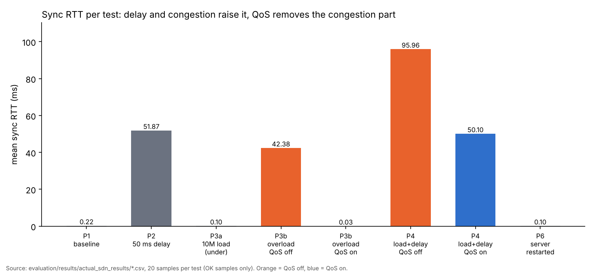
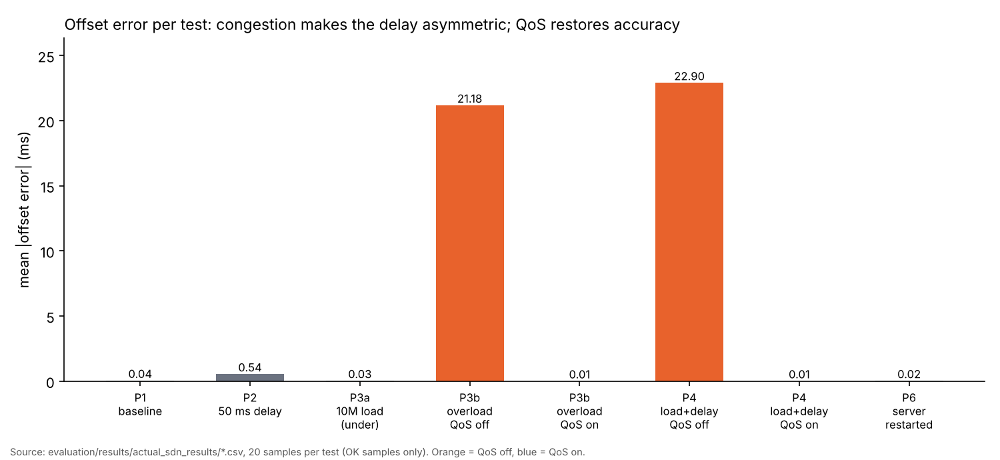
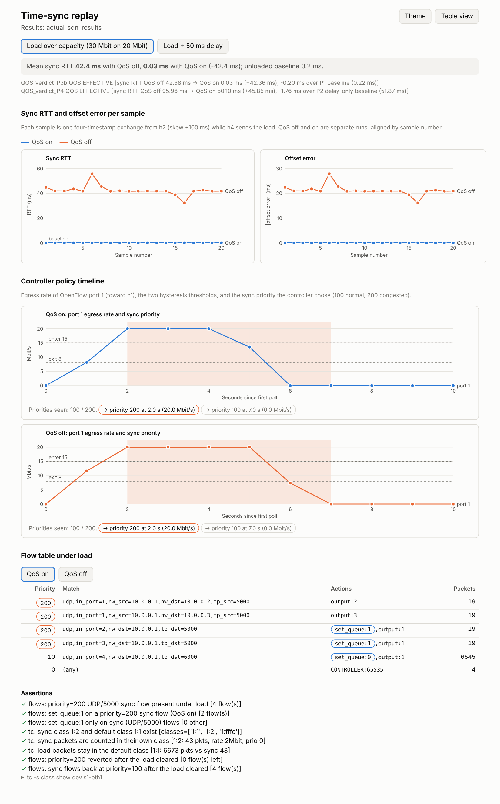
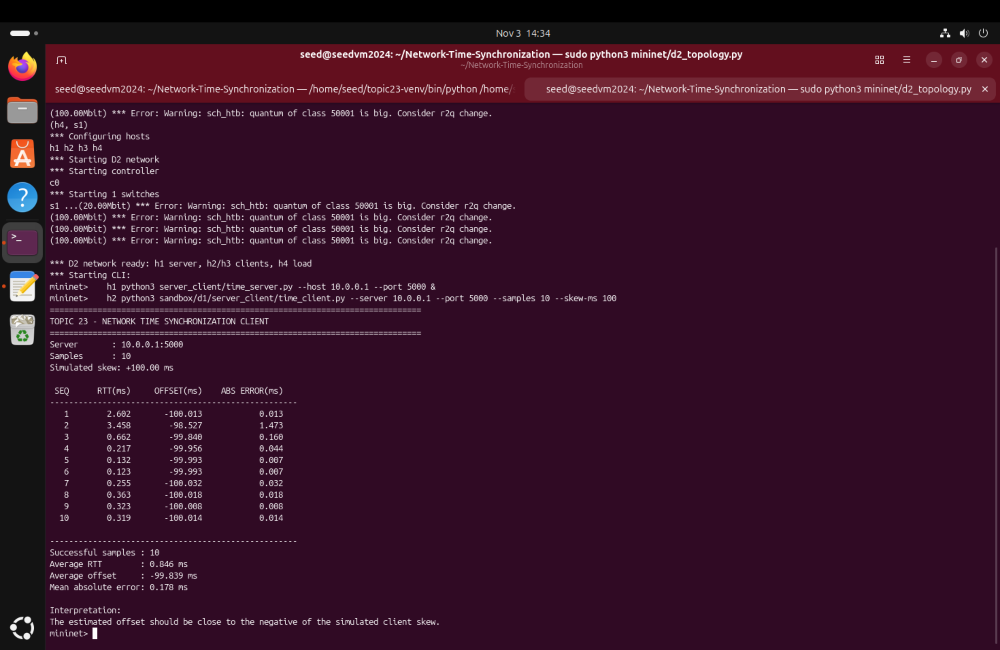
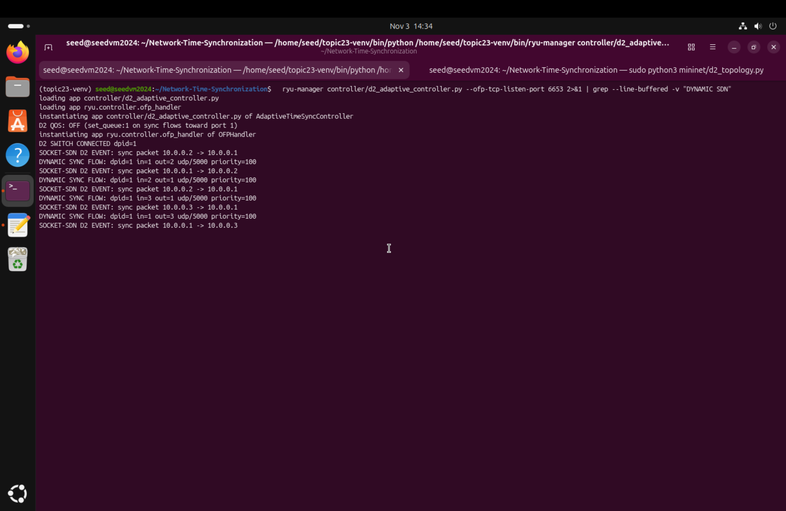
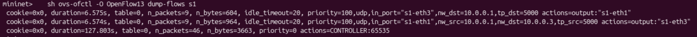
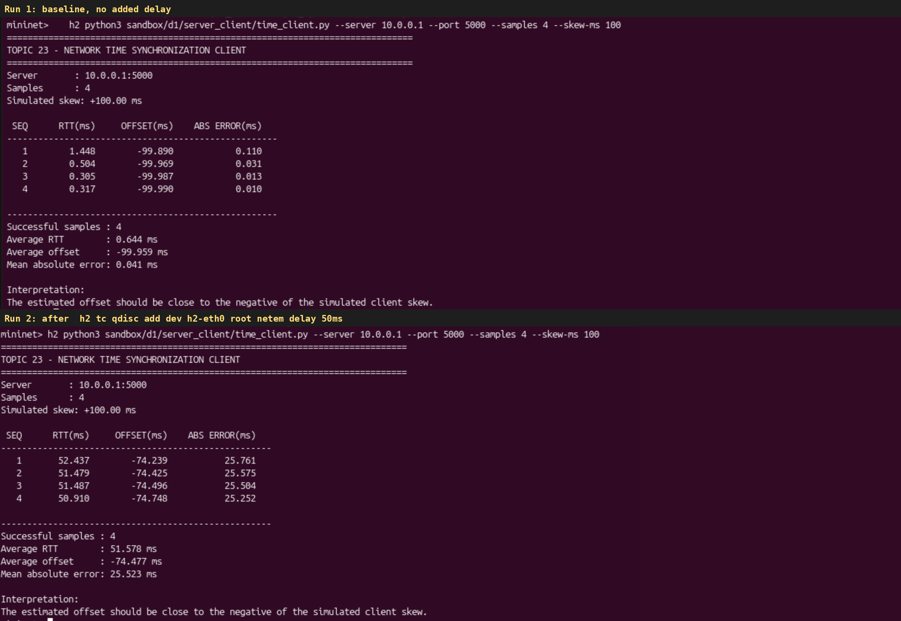

# Network Time Synchronization over SDN (Topic 23)

A UDP reference time server, NTP-style clients (four timestamps), and a Ryu OpenFlow 1.3 controller that watches the
network and protects the sync traffic when a background load congests the path. Everything runs in Mininet with Open
vSwitch on Ubuntu. The D1 prototype lives in [`sandbox/d1/`](sandbox/d1/).

Educational project for PES University coursework (Computer Networks). Team of three: see [CONTRIBUTIONS.md](CONTRIBUTIONS.md).

## Contents

1. [Objectives](#objectives)
2. [What it does](#what-it-does)
3. [Architecture](#architecture)
4. [Results and screenshots](#results-and-screenshots)
5. [Team contributions](#team-contributions)
6. [Repository layout](#repository-layout)
7. [Install and run](#install-and-run)
8. [Limitations](#limitations)

## Objectives

- Build a UDP time synchronization system: a reference server and clients that estimate round-trip delay and clock offset
  from four timestamps.
- Run it in a reproducible virtual network (Mininet + Open vSwitch) with controllable delay and load.
- Use an SDN controller (Ryu, OpenFlow 1.3) that recognises the sync traffic by its UDP port and treats it specially
  (socket-SDN integration).
- Measure how delay, congestion and server failure affect the estimate, and show what the controller can do about it.

## What it does

- **Time sync.** A client sends `REQ|seq|T1`; the server replies `REP|seq|T1|T2|T3`; the client records T4 and computes
  `RTT = (T4 - T1) - (T3 - T2)` and `offset = ((T2 - T1) + (T3 - T4)) / 2`. Clients can simulate a wrong clock with
  `--skew-ms`; the system clock is never changed.
- **Multiple clients.** h2 (skew +100 ms) and h3 (skew -50 ms) sync against one server (h1).
- **Socket-SDN integration.** The controller detects UDP/5000 packets and installs dedicated priority-100 flows, one per
  direction per client.
- **Dynamic SDN.** It polls the port toward the server; when the link is congested (at or above 15 Mbit/s) it moves the sync
  flows to priority 200, and reverts when the load clears (hysteresis: 2 polls at or below 8 Mbit/s).
- **QoS.** OpenFlow priority only orders flow lookups, so with `D2_QOS=on` the sync flows also carry `set_queue:1`, a
  protected OVS htb queue on the bottleneck port.
- **Evaluation.** Automated scenarios (baseline, 50 ms delay, load under/over capacity, load plus delay, server down and
  restarted) with PASS/FAIL assertions on the flow tables and queue counters.

## Architecture

```text
                 Ryu controller (controller/d2_adaptive_controller.py)
                        |  OpenFlow 1.3: port stats, flow-mods
                  +-----------+
 h1 server  ------|    s1     |------ h2 client (skew +100 ms)
 10.0.0.1   20M   |    OVS    |------ h3 client (second skew)
 UDP 5000         +-----------+------ h4 load generator -> h1 UDP 6000
```

- **h1** runs `server_client/time_server.py` on `10.0.0.1:5000`. Its link to s1 is the 20 Mbit bottleneck that sync
  replies and the load share.
- **h2 / h3** are sync clients. `--skew-ms` simulates a wrong local clock without changing the OS clock.
- **h4** sends background UDP (port 6000) toward h1.
- **Controller** learns MACs, installs a UDP/5000 sync flow (priority 100, raised to 200 under congestion) and classifies
  UDP/6000 as background.

```text
Client                      Server
T1 ---- REQ|seq|T1 ------->  T2
T4 <--- REP|seq|T1|T2|T3 --  T3

RTT    = (T4 - T1) - (T3 - T2)
Offset = ((T2 - T1) + (T3 - T4)) / 2
```

Full design, flow-table layout, controller logic and design rationale: **[docs/ARCHITECTURE.md](docs/ARCHITECTURE.md)**.

## Results and screenshots

Measured on an Ubuntu VM (Mininet, Ryu, kernel Open vSwitch 3.7.1), 20 samples per test. Source files:
`evaluation/results/actual_sdn_results/`; interpretation and caveats: [`evaluation/RESULT_STATUS.md`](evaluation/RESULT_STATUS.md),
[`docs/D2_REPORT.md`](docs/D2_REPORT.md).

| Test | Mean RTT | Mean abs. offset error |
|---|---:|---:|
| P1 baseline | 0.22 ms | 0.045 ms |
| P2 50 ms delay | 51.87 ms | 0.540 ms |
| P3b overload, QoS off | 42.38 ms | 21.18 ms |
| P3b overload, QoS on | 0.03 ms | 0.006 ms |
| P4 load + delay, QoS off | 95.96 ms | 22.90 ms |
| P4 load + delay, QoS on | 50.10 ms | 0.011 ms |

Congestion on one direction makes the delays asymmetric, and the offset error is about half of the difference; QoS removes
it. The overload load was nominally 30M but measured about 19.5 Mbit/s at the sender with no loss (see `RESULT_STATUS.md`).





Live terminal captures from the Ubuntu VM (D2 topology): client sync with a +100 ms skew, the controller recognising sync
traffic and installing priority-100 flows, the switch flow table, and the 50 ms delay experiment.






All captures, with the command behind each: [`screenshots/`](screenshots/README.md).

## Team contributions

Summary table and per-track details: [CONTRIBUTIONS.md](CONTRIBUTIONS.md).

## Repository layout

| Path | What |
|---|---|
| `server_client/` | `time_server.py` (+ kernel timestamps), `load_generator.py`, sync-loop modules |
| `controller/d2_adaptive_controller.py` | Ryu D2 controller |
| `mininet/d2_topology.py`, `d2_qos.py` | Topology; OVS QoS queues |
| `sandbox/d1/` | The D1 project: client, topology, controller, report, demo script |
| `evaluation/` | Evaluation client, automated runner, results, result status |
| `tests/` | Unit tests (no root needed) |
| `run_d2.sh` | One command: tests, run, PASS/FAIL table |
| `scripts/install_ubuntu.sh` | Installs Mininet, Open vSwitch and a pinned Ryu venv |
| `docs/` | `ARCHITECTURE.md`, `D2_REPORT.md`, `SYNC_LOOP.md` |
| `screenshots/` | Result figures and replay-page renderings |
| `CONTRIBUTIONS.md` | Who did what |

## Install and run

Requires Ubuntu (a VM is fine) with root. Windows alone is not enough for the Mininet part.

```bash
./scripts/install_ubuntu.sh        # Mininet, Open vSwitch, Ryu in ~/topic23-venv
sudo apt install -y iperf          # load generator used by the evaluation
```

### Everything in one command

```bash
sudo ./run_d2.sh        # sandbox tests, Mininet/SDN run, PASS/FAIL table; exit 0 only if nothing failed
./run_d2.sh --sandbox-only   # no root: loopback and unit tests only
```

The software-clock sync loop is separate: `sudo ./evaluation/ubuntu_runner/run_sync_loop.sh`; see
[docs/SYNC_LOOP.md](docs/SYNC_LOOP.md).

### Evaluation only

```bash
sudo env EVAL_CHECK_ONLY=1 ./evaluation/ubuntu_runner/run_evaluation.sh   # probe only
sudo ./evaluation/ubuntu_runner/run_evaluation.sh                         # full run
```

Results go to `evaluation/results/actual_sdn_results/` (start with `SUMMARY.txt`). Set
`EVAL_RYU_MANAGER=~/topic23-venv/bin/ryu-manager` if `ryu-manager` is not found.

### Interactive demo

1. Controller (add `D2_QOS=on` for the QoS-on case): `ryu-manager controller/d2_adaptive_controller.py --ofp-tcp-listen-port 6653`
2. Topology: `sudo python3 mininet/d2_topology.py [--qos on]`
3. In the Mininet CLI, **server and clients first, `pingall` only afterwards** (otherwise generic flows pre-empt the sync flow):

   ```text
   h1 python3 server_client/time_server.py --host 10.0.0.1 --port 5000 &
   h2 python3 sandbox/d1/server_client/time_client.py --server 10.0.0.1 --port 5000 --samples 10 --skew-ms 100
   h3 python3 sandbox/d1/server_client/time_client.py --server 10.0.0.1 --port 5000 --samples 10 --skew-ms -50
   sh ovs-ofctl -O OpenFlow13 dump-flows s1
   pingall
   ```
4. Delay experiment: `h2 tc qdisc add dev h2-eth0 root netem delay 50ms`, rerun the h2 client, then
   `h2 tc qdisc del dev h2-eth0 root`.
5. Offline replay of a run: `python3 evaluation/code/build_replay.py <results_dir>` and open the `replay.html` it writes.

More commands: [`evaluation/docs/EVALUATION_COMMANDS.md`](evaluation/docs/EVALUATION_COMMANDS.md). The original D1 walkthrough
is in [`sandbox/d1/README.md`](sandbox/d1/README.md).

Clean up: `exit` in Mininet, then `sudo mn -c`.

## Limitations

Educational prototype, not production NTP. The controller classifies sync traffic by UDP port 5000 and detects
congestion with a simple traffic-volume threshold on one port. Results come from a single VM run. See
[docs/ARCHITECTURE.md](docs/ARCHITECTURE.md#8-limitations).
